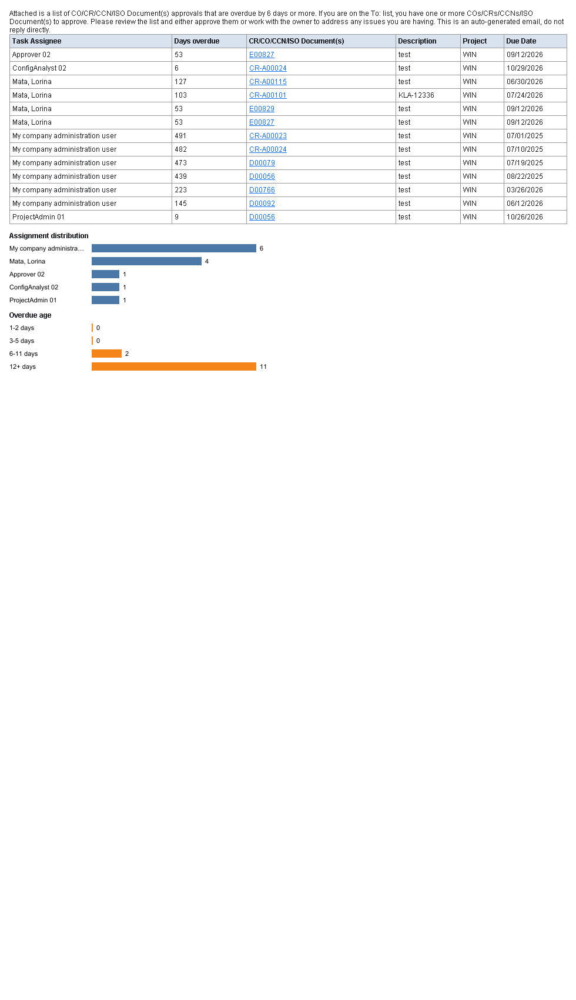

MailBox
=======

**Local Email Testing & Inspection Studio**

*Capture. Preview. Inspect.*

MailBox is a lightweight desktop application for local SMTP email testing, email capture, HTML email rendering, attachment inspection and developer-focused email diagnostics.

Configure your application to use `localhost` (default port **25**) as the SMTP server. Every message is intercepted, saved as `.eml`, and shown in the inbox with HTML rendering, search, flags, export, and desktop notifications.

MailBox originated from the [FakeSMTP](https://github.com/Nilhcem/FakeSMTP) project by Nilhcem. The SMTP stack, CLI options, and persistence behavior are preserved. Licensed under BSD or GPL, whichever you prefer.


Requirements
------------

- **Java 8 or newer** to run the jar (also works on Java 11, 17, and 21)
- **JDK 8+ and Maven 3.9+** to build from source

On Unix-like systems you may need root (or another port ≥ 1024) to bind port 25.


Screenshots
-----------

Empty inbox after starting the server on port 25:


HTML email rendered in the reading pane (tables, links, and charts):



Desktop notification (in-window toast; tray balloon is also used when the OS supports it):


Build the jar
-------------

From the project root:

```bash
mvn clean package
```

Output file:

```text
target/MailBox.jar
```

Recommended (full check):

```bash
mvn clean verify
```


Download the jar
----------------

### From a local build

```text
target/MailBox.jar
```

### From GitHub Releases / Actions (when published)

1. Open [techpranav/MailBox](https://github.com/techpranav/MailBox).
2. Download `MailBox.jar`.
3. Keep Java 8+ installed on the machine that will run it.

### From this repository (developers)

```bash
git clone https://github.com/techpranav/MailBox.git
cd MailBox
mvn clean package
```


Run the jar
-----------

```bash
java -jar MailBox.jar
```

Start listening immediately on port 25:

```bash
java -jar MailBox.jar -s
```

Custom port and output folder:

```bash
java -jar MailBox.jar -s -p 2525 -o received-emails
```

Background mode (no GUI — SMTP only):

```bash
java -jar MailBox.jar -s -b -p 2525 -a 127.0.0.1 -o received-emails
```

Memory mode (do not write `.eml` files):

```bash
java -jar MailBox.jar -s -m
```

Help:

```bash
java -jar MailBox.jar --help
```

Point your application SMTP host to `localhost` and the same port shown in the header (use **Copy host:port** to copy `localhost:25`).


Inbox features
--------------

- Mail-client layout: Inbox, Unread, Flagged, All Emails, Attachments, SMTP log
- Search, sort (newest / oldest / subject / sender / flagged), refresh (`F5`)
- **Send test email** (HTML, links, table, chart, attachments) without an SMTP client
- HTML / plain text / headers / raw MIME views; flag messages from the reading pane
- Export: Outlook `.msg`, `.eml`, and full-height HTML PNG screenshot
- Safe HTML: no JavaScript, remote images blocked until you allow them
- Tables, links, CID images, SVG charts (rasterized)
- Desktop notifications (tray + in-window toast) with optional sound
- **Test desktop notification** in Settings
- Copy message, open emails folder, mark all read (`Ctrl+Shift+A`), delete (`Delete`)
- Light / dark theme

Settings live in `~/.mailbox-ui.properties` (legacy `~/.fakeSMTP-ui.properties` is still read). Port and output directory use `~/.mailbox.properties` (legacy `~/.fakeSMTP.properties` is still read).

See [`docs/FEATURES.md`](docs/FEATURES.md), [`docs/ARCHITECTURE.md`](docs/ARCHITECTURE.md), [`docs/TESTING.md`](docs/TESTING.md), [`docs/BUILD_AND_RELEASE.md`](docs/BUILD_AND_RELEASE.md), and [`docs/ULM_INTEGRATION.md`](docs/ULM_INTEGRATION.md).


Notifications
-------------

Notifications are **on by default**.

1. Toggle **Notifications** in the header, or open **Settings**.
2. Click **Test desktop notification** to verify tray / toast on your machine.
3. When a real email arrives, MailBox shows an in-window toast and, when available, a system tray balloon (or `notify-send` on Linux).
4. Click the toast or tray icon to focus MailBox and open that message.

Optional: include a short preview, play a beep, or notify even while the window is focused.


Integration tests
-----------------

```bash
mvn verify
```

`SendEmailsIT` starts an embedded server on port 2525 when needed.
`PackagedJarIT` launches the built jar in background mode and checks that mail is saved.


Usage on Docker
---------------

Build from source (preferred):

```bash
mvn package
docker build -f src/main/docker/Dockerfile -t mailbox target
docker run -ti -d -p 250:25 -v /home/mailbox/mail:/output mailbox
```

The root `Dockerfile` still downloads the upstream FakeSMTP 2.0 zip for historical reference.


Origin and license
------------------

MailBox is a branded continuation of FakeSMTP. Upstream project: [Nilhcem/FakeSMTP](https://github.com/Nilhcem/FakeSMTP).

Copyright notices and the BSD/GPL dual license in `LICENSE.txt` are preserved.
