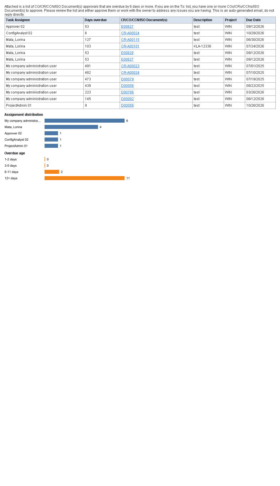

# Features

The original SMTP test server is unchanged: configurable port and bind address, output directory, memory mode, background mode, auto-start, relay domains, and the external `.eml` viewer.

## Inbox

The window is a mail client layout: header, sidebar, message list, and reading pane.

- Sidebar: Inbox, Unread, All Emails, Attachments, and the SMTP log. Each mailbox shows a count.
- List: sender, subject, preview, time, unread emphasis, attachment mark. Search covers sender, recipient, subject, and preview. Sort newest or oldest.
- Reading pane: HTML, plain text, headers, and raw MIME. Mark read or unread, delete one message, open the saved `.eml`.
- Attachments: name, type, size, Content-ID. Save (names are reduced to a single safe file name), open with the system application on an explicit click, and preview images.
- Empty states for no mail, no search hits, no unread mail, no attachments, and nothing selected.
- Clear all still asks before deleting saved files.

## HTML

HTML and multipart messages are shown as laid-out mail, including tables, inline CSS, `cid:` images, data-URL images, and SVG charts (drawn as PNG). Plain text is available beside the HTML. A broken message falls back to plain text or the raw source and does not stop the server.

JavaScript is not executed. Remote images stay blocked until the user clicks **Load images** or enables them in settings. `file:` and `javascript:` URLs are not loaded.

The overdue-approval sample renders like this:

## Notifications

On by default. A new message shows the sender, subject, and a short preview (the preview can be hidden). Windows and macOS use the system tray. Linux uses the tray or `notify-send` when `notify-send` exists. Otherwise a notice appears inside the window. Clicking a tray balloon or the in-window notice focuses FakeSMTP and selects that message. A sound is optional and off by default.

Notifications are skipped when the window is focused unless **Notify even when FakeSMTP is focused** is on. A notification failure does not affect delivery.

## Themes and settings

Light is the default. Dark is available from the header. Settings are saved in `~/.fakeSMTP-ui.properties`.

## Limitations

- The HTML renderer supports CSS 2.1 (tables, inline styles, borders, basic layout). It does not apply flexbox, grid, or media queries.
- SVG is converted to a bitmap, so it is not selectable text.
- Emoji depend on fonts installed on the machine.
- A tray click selects the most recent notified message.
- Read/unread state is not kept across restarts.
- The original root `Dockerfile` still downloads the upstream 2.0 zip. The image built from source uses Java 21.
